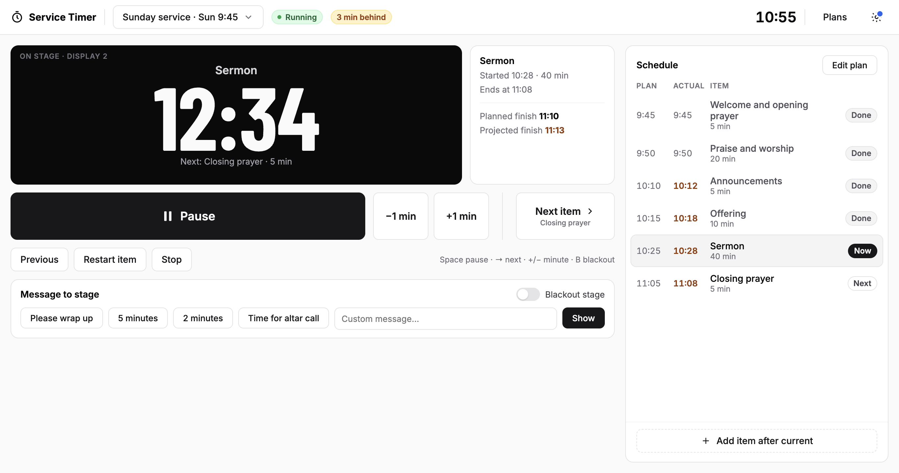
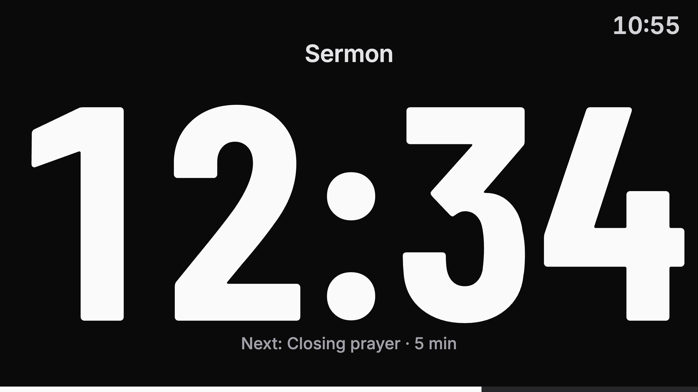
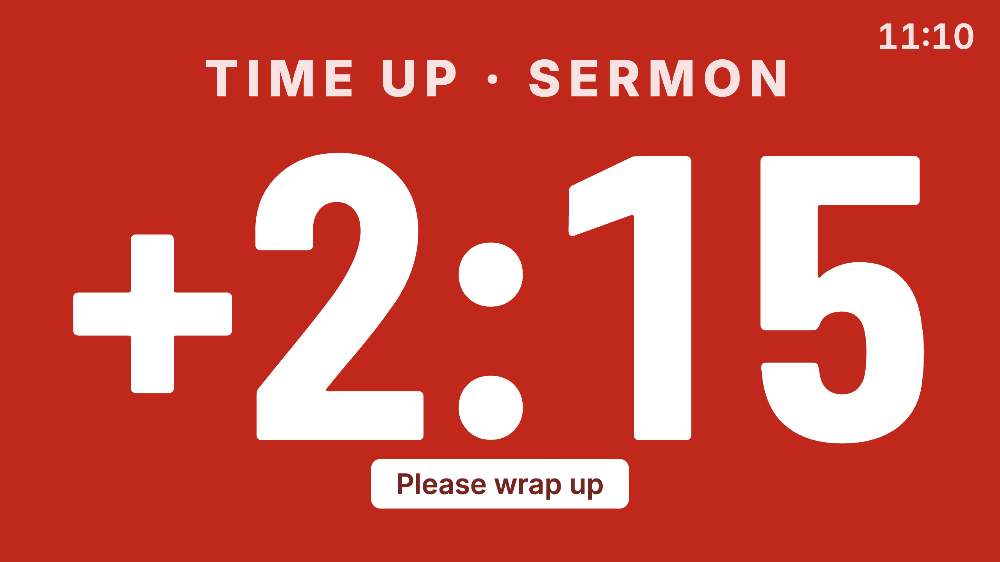
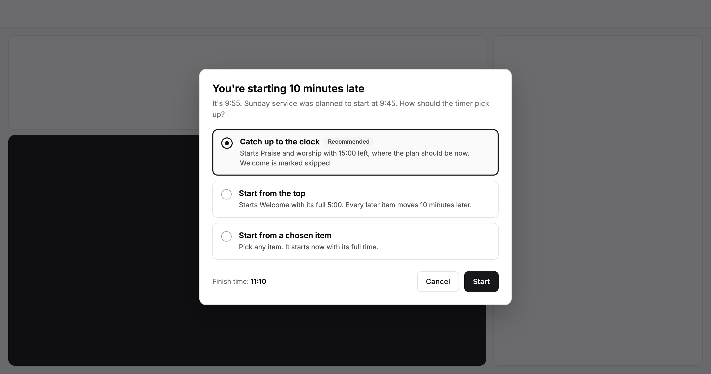

# UI mockup

Static reference screens for Service Timer, drawn in the shadcn/ui zinc style. Each screen is a self-contained HTML file (open it in a browser) with a PNG of the same screen in `screenshots/`.

These are pictures of the app, not the app. Use them for layout, hierarchy, sizes and copy, and build the real thing with shadcn/ui components. Where a screen and `SPEC.md` disagree, `SPEC.md` wins (for example, the time-up red is `#D00000`).

Control screens are drawn at 1366×720 (a 1366×768 laptop with the taskbar showing). Stage screens are drawn at 1280×720 and must scale to any resolution (SS-6).

All screens use the reference plan from the acceptance tests: Sunday service at 9:45, finishing 11:10.

| # | Screen | Shows | Requirements |
| --- | --- | --- | --- |
| 01 | [Control, Sunday morning waiting](01-control-waiting.html) | 9:31, auto-start armed. "Nothing to do. The timer starts itself at 9:45", with Start now, Start from another item and Turn off auto-start today. | FR-18, Waiting state |
| 02 | [Stage, before the service](02-stage-waiting.html) | Countdown to the 9:45 start and the first item. | FR-18, Waiting state |
| 03 | [Control, running](03-control-running.html) | Sermon running, 12:34 left at 10:55, 3 min behind. One dominant Pause button, ±1 min, Next item set apart, stage messages, blackout, schedule with planned and actual starts. | FR-8 to FR-11 |
| 04 | [Stage, running](04-stage-running.html) | Huge countdown, item title, next item, large wall clock. | FR-1 to FR-3 |
| 05 | [Stage, time up](05-stage-time-up.html) | Whole screen red, overrun +2:15 as the hero, "TIME UP · SERMON" label, "Please wrap up" banner. | FR-4, FR-5 |
| 06 | [Control, reordering while running](06-control-reorder.html) | Announcements running with a Testimony added. Drag handles, Move up/down, Do next, current item locked, Undo toast. | FR-13, FR-14, FR-14a |
| 07 | [Late start prompt](07-late-start.html) | 9:55, 10 minutes late. Catch up to the clock (default), Start from the top, Start from a chosen item, each with its finish time. | FR-16 |
| 08 | [Saved plans and editor](08-plans-editor.html) | Plan library (recurring and one-off) and the editor: start time, days (Sun, Mon...), auto-start, item rows. Delete plan sits away from Export. | FR-12, FR-12a |
| 09 | [Settings](09-settings.html) | Stage display first (display picker, Identify, time-up style), then startup and power, plans and backup, updates last. | SS-1, FR-4, EXE-5, EXE-11 to EXE-13 |

States not drawn as separate screens: the no-second-screen banner (SS-4), the amber warning band (FR-3), blackout (FR-6) and the "Update ready" dot on Settings. Build them from the spec.

## Screenshots

